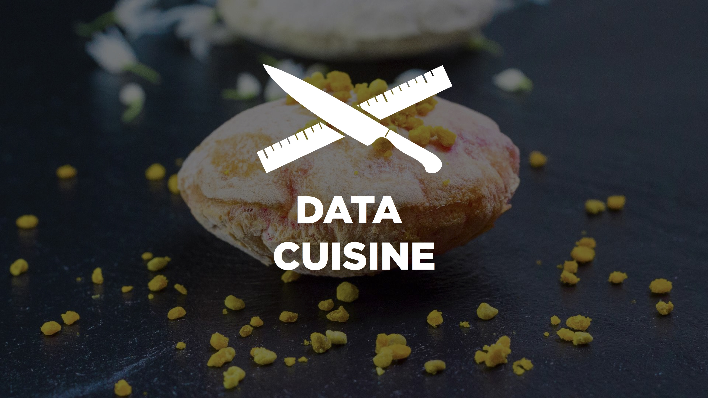
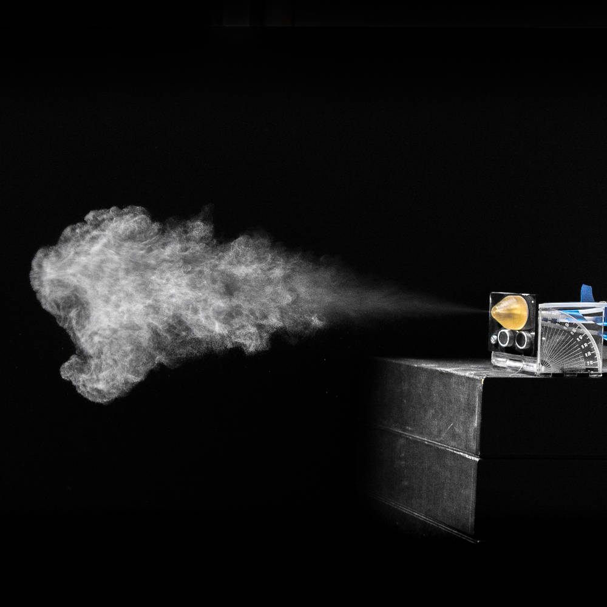

---
# Extends metadata from _quarto.yml
subtitle: "Studio: Interaction (Input, Cameras, Sensors)"
date: 2026-10-13
---



# Today's outline

- Studio: Hack an interactive artifact

## Modalities covered so far

- [*Audio*](lecture-audio.html): Synthesis, Sampling, Spatial
- [*Vision*](lecture-vision.html): Graphics, Video, Projection Mapping
- [*Touch*](lecture-touch.html): Haptics

## Leveraging our other senses

:::: {.columns}
::: {.column width="50%"}

Gustatory: <a href="http://data-cuisine.net">Data Cuisine</a>

:::
::: {.column width="50%"}

Olfactory: <a href="https://multi-sensory.info/index.php/component/spsimpleportfolio/item/11-owidgets">OWidgets</a>

:::
::::

# Studio

Hack an interactive artifact

## Find your interactive artifact

- (Either) Pick a [Arduino](https://www.arduino.cc/en/software/) example
    - (Easiest  - should work directly)
- (Or) Find a sample that fits your individual pitch idea(s)    
    - (Harder - even more complex and you might have to fix it): find an interactive example on [GitHub](https://github.com) (that fits your individual pitch)!

## Install Arduino IDE

[Arduino IDE](https://www.arduino.cc/en/software/)

## Explore examples

- [Learn | Arduino Documentation](https://docs.arduino.cc/learn/)
- [Programming | Arduino Documentation](https://docs.arduino.cc/programming/)
- [Libraries | Arduino Documentation](https://docs.arduino.cc/libraries/)
- [Plaquette — Plaquette 0.9.4 documentation](https://plaquette.org/)

## Modify your chosen artifact creatively

- Focus on changes that will affect the interactive experience.
- Make the interaction modality more complex.
- Combine examples if you wish!

## Prepare your interactive presentation

- Create a file named: `interactive-presentation-interaction.qmd`
- Clarify the provenance (what example(s) you used).
- Explain your intent, design idea.
- Describe your creative updates.
- Overview what you might have done next with more time.
